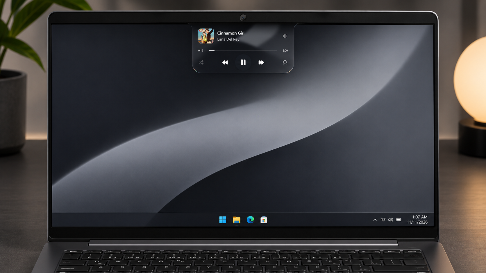
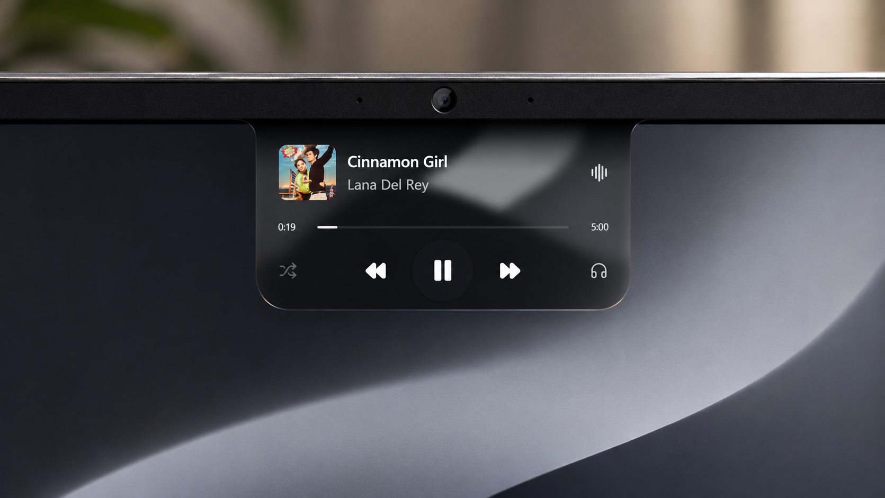
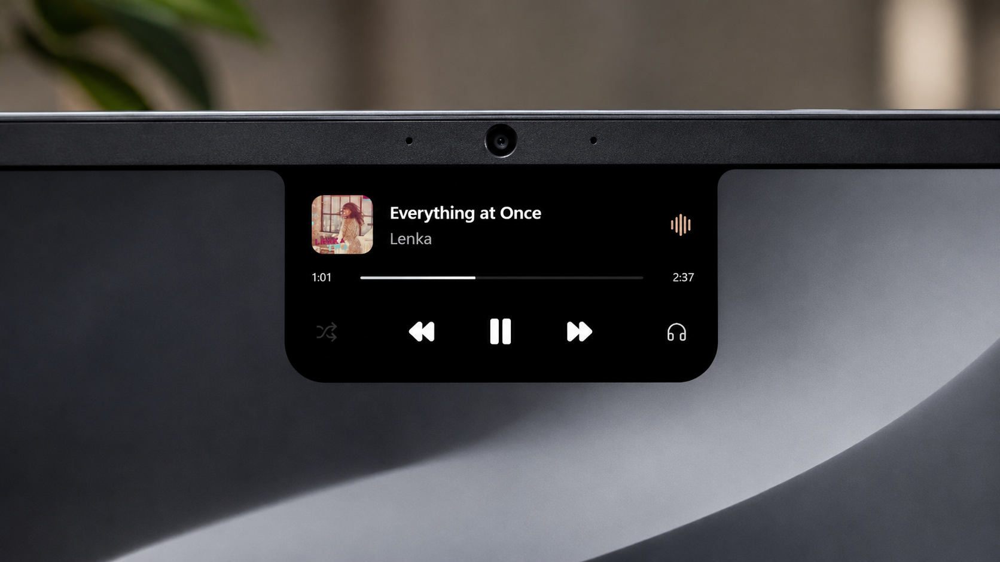
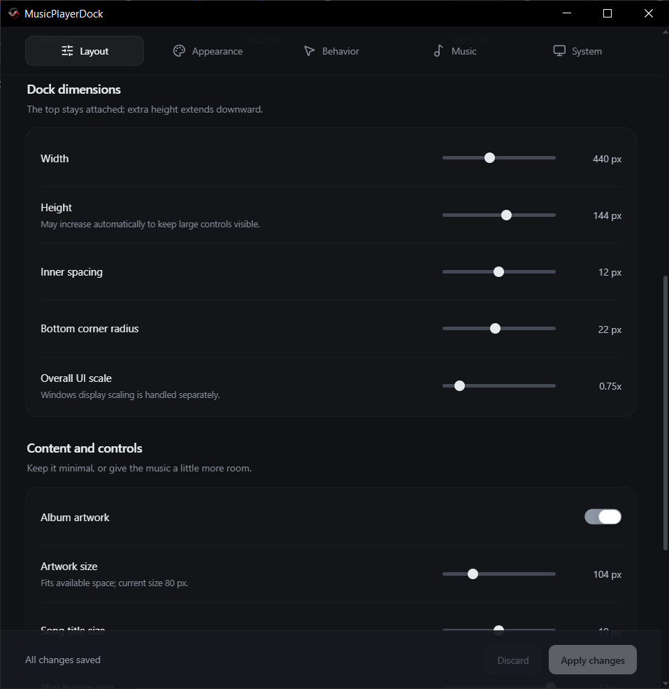

  
  <h1>MusicPlayerDock</h1>
  
<strong>Your music, within reach.</strong>

  
A music island for Windows, shaped around your desktop.

  

    <a href="https://github.com/kaveesha-neth/music-player-dock/releases/latest"><strong>Download for Windows</strong></a>
    &nbsp;&middot;&nbsp;
    <a href="#make-it-yours">Explore customization</a>
    &nbsp;&middot;&nbsp;
    <a href="https://github.com/kaveesha-neth/music-player-dock/issues">Support &amp; feedback</a>
  

  
Windows 10 &amp; 11 &nbsp;&middot;&nbsp; Portable &nbsp;&middot;&nbsp; Open source

  

MusicPlayerDock brings your current track, album artwork and playback controls to the top of your screen. Move your pointer to the top center to reveal it. Leave, and it slips out of the way.

Control the music already playing in your favorite compatible apps, with a dock that feels at home on your desktop.

## Choose your look

<table>
  <tr>
    <td width="50%" valign="top">
      
      <h3>Liquid Glass</h3>
      
Live desktop blur, refracted edges and soft reflections. Curved bevels join the glass to the top of your screen, while a black fade and subtle border shading add depth.

      
Adjust the blur, edge warping, black edge shade, tint and color separation to find your finish.

    </td>
    <td width="50%" valign="top">
      
      <h3>Black Notch</h3>
      
Pure black, clean typography and a borderless silhouette. Rounded lower corners and curved shoulders connect the dock to the screen edge.

      
The default look: focused controls, a monochrome timeline and a quiet presence.

    </td>
  </tr>
</table>

Each style remembers its own layout, so you can switch looks without rebuilding your setup.

## Everything you need, close to the music

| Playback at a glance | A considered desktop presence |
| --- | --- |
| Current song, artist, album and artwork | Reveal from the top edge without taking keyboard focus |
| Play, pause, previous and next | Adjustable auto-hide, or keep the dock open |
| Smooth progress and seeking when supported | A minimal handle or a fully hidden resting state |
| Shuffle and repeat when your player supports them | Artwork, text and icon transitions with reduced-motion support |
| Automatic or manual media-source selection | Preferred display, fullscreen hiding and Windows startup options |
| Windows output-device indicator, including headphones | Quick access to Windows sound settings |

The dock follows compatible Windows media sessions. Spotify, YouTube, YouTube Music and Windows media apps can appear when the app or browser publishes Windows media controls. Available artwork, timing and actions depend on the player.

## Make it yours

**Fully customizable from Settings.** Start with Compact, Comfort or Roomy, then adjust the details to suit your display, wallpaper and workflow.

| Setting area | What you can customize |
| --- | --- |
| **Layout** | Width, height, inner spacing, corner radius and overall scale. Set artwork, title and play-button sizes; choose whether album names, time labels and optional controls appear. |
| **Glass & appearance** | Liquid Glass blur, lens magnification, edge warping, black edge shade, tint and color separation. Choose a solid-white or silver-to-white progress bar and adjust its thickness. |
| **Behavior & motion** | Auto-hide, hide delay, trigger width and height, handle visibility, animations and reduced motion. |
| **Music** | Follow the Windows media session, choose a preferred source or switch between available players. |
| **System** | Preferred monitor, fullscreen hiding, start with Windows and access to Windows sound settings. |

Preview layout and appearance changes before applying them. Preferences are saved between sessions, with **Apply**, **Discard** and **Restore defaults** controls. Liquid Glass also offers capture-rate and resolution adjustments so you can balance detail with resource use.

  

## Get started

1. Download the Windows ZIP from the [latest release](https://github.com/kaveesha-neth/music-player-dock/releases/latest).
2. Extract the complete folder to a location you want to keep.
3. Open **MusicPlayerDock.exe**, start music in a compatible app, and move your pointer to the top center of the display.

Open **Settings** from the MusicPlayerDock icon in the Windows notification area. The dock starts with Black Notch; choose Liquid Glass under **Appearance** and apply your changes to switch.

The portable download runs on **Windows 10 version 2004 or newer, and Windows 11, on x64 PCs**. Keep its files together. To update, quit the existing instance from the tray before launching the new version. If you use Start with Windows, keep the extracted folder in a stable location.

## Glass that responds to your desktop

Liquid Glass samples the area behind the dock and processes it locally to create blur and refraction. Desktop images are not saved or uploaded, and screen sampling pauses while the dock is hidden.

Liquid Glass is an experimental effect. Its appearance and availability depend on Windows capture support and your graphics system. If live capture is unavailable, the dock uses a labeled fallback surface; **Appearance > Retry desktop glass** lets you retry.

To prevent the dock from capturing itself, Windows capture protection is enabled for Liquid Glass. As a result, the dock may be absent from screenshots and screen sharing while that style is selected.

## Good to know

  
<strong>Why is my player missing, or a control unavailable?</strong>

  
The player needs to publish a Windows media session. Some browser tabs, live streams and applications provide limited artwork, timeline information or playback actions. Start playback in the source app first; supported controls appear automatically.

  
<strong>Does the device icon show my player's output?</strong>

  
It shows the Windows default multimedia output and updates for speakers, headphones and other device types. A player with its own output routing may use a different device. Click the icon to open Windows sound settings.

  
<strong>Why does Windows show an unknown-publisher prompt?</strong>

  
Current releases are not digitally signed, so Windows may show an unknown-publisher prompt. Use the official GitHub Releases page for downloads.

## Built for Windows

The interface uses **React**, **TypeScript** and **Glisse**, with **WebGL** for the live glass effects. **Electron** provides the desktop overlay, while native **.NET / Windows media and audio APIs** connect it to your players and output devices.

---

  <a href="https://github.com/kaveesha-neth/music-player-dock/releases">Releases</a>
  &nbsp;&middot;&nbsp;
  <a href="https://github.com/kaveesha-neth/music-player-dock/issues">Report an issue</a>
  &nbsp;&middot;&nbsp;
  <a href="LICENSE">MIT License</a>

